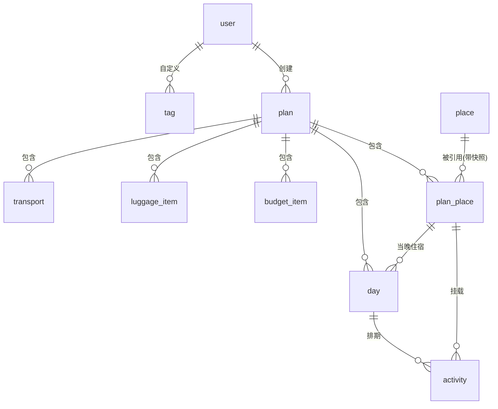

# 旅行计划管理系统 · 需求规格说明书（SRS）

> 版本：v1.0（2026-10-10）
> 依据：《需求.md》及三轮需求澄清（v1.0 / v2.0 / v3.0 答案文件）汇总而成。
> 本文档为开发评审基线，评审通过后进入开发；标注【默认决策】的条目为本轮替用户做的合理默认，评审时可修改。

---

## 1. 项目概述

### 1.1 系统定位
面向个人及身边人使用的**旅行计划制定工具**：通过地图化交互录入目的地（景点/酒店）、活动、交通，系统自动完成时间轴推算、冲突检测、单日路线优化与预算汇总，最终导出格式美观的 PDF 行程单。

### 1.2 用户与规模
- 用户：开发者本人及身边人，用户量 < 50，部署于服务器供他人访问
- 数据量级：单计划景点 ≤ 100，单日活动 ≤ 12，计划数/用户 < 10
- 使用节奏：出行前制定 + 旅途中随时修改

### 1.3 范围
- 仅国内（GCJ-02 坐标系）、仅中文、仅人民币
- v1 明确不做（后置）：实际花费对比、景点收藏、锚点排程、多人协作/分享链接、移动端适配、行程模板、天气/票价实时查询、行李按人/按箱分配

---

## 2. 总体架构与技术栈

| 层 | 选型 |
|---|---|
| 前端 | Vue 3 + TypeScript + Vite + **Vben Admin v5**（登录/布局/用户管理），计划编辑器为其内自定义页面 |
| 后端 | Node.js + **NestJS + TypeScript** |
| 数据库 | MySQL 8 |
| 地图 | **高德开放平台**：JS API 2.0（前端地图渲染）+ Web 服务 API（POI 搜索、逆地理编码、路径规划、静态地图），两种 key 全局配置于系统设置 |
| PDF | HTML 模板 + **Puppeteer** 服务端渲染转 PDF |
| 图片存储 | 服务器本地磁盘固定目录 |
| 开发环境 | Windows 本机直跑（Node 20 LTS + MySQL 8），两台开发机（含 i3-10105/16GB）均可运行 |
| 部署 | docker-compose（Nginx + API + MySQL），仅用于服务器 |

---

## 3. 角色与数据归属

| 角色 | 权限 |
|---|---|
| 普通用户 | 注册登录；管理**自己的**计划（行程/预算/行李/PDF）；使用全局共享景点库 |
| 管理员 | 用户管理；系统设置（高德 key 等） |

数据归属规则：
- **计划及行程数据私有**：按登录用户隔离，用户只能看到自己的全部计划，无授权/共享功能
- **景点库全局共享**：所有用户共用一个地点池，A 录入 B 可用；计划引用时保存**字段快照**，库信息更新不影响已引用计划，计划内可手动"同步最新"
- 景点去重：录入时按"名称相似 + 坐标相近"提示已存在条目，可直接使用，不强制合并
- 从计划移除地点不影响景点库

---

## 4. 功能需求

### M1 认证与用户（Vben 自带体系）
- F1.1 注册：用户名 + 密码（管理员也可后台创建账号）
- F1.2 登录 / 登出（JWT）
- F1.3 修改个人信息 / 密码

### M2 计划管理
- F2.1 计划列表：本人计划卡片/表格（封面缩略、标题、日期范围、天数、预算执行概览）
- F2.2 计划元信息：标题、出行日期范围、同行人数、封面图（上传，可不传）、总预算上限、备注
- F2.3 复制计划：完整复制行程、预算、行李清单
- F2.4 删除计划：二次确认

### M3 景点库与地图（核心交互模块）
- F3.1 **地图选点**（三种方式均支持）：
  - a) 地图搜索框搜 POI（关键词 → 结果列表 → 加入）
  - b) 点击地图任意位置创建自定义地点（坐标自动获取，名称手填）
  - c) 已有地点标记可拖动微调位置
- F3.2 地点字段：名称、**类型**（景点/酒店/餐饮/购物/其他）、经纬度、地址、城市（逆地理编码自动判断 + 可改）、开放时间（每日统一时段 + 每周闭馆日）、门票价格、建议游玩时长、评分、是否需预约、备注
- F3.3 酒店 = 类型为"酒店"的地点，额外带**每晚价格**字段
- F3.4 引用快照与"同步最新"（见第 3 节数据归属）
- F3.5 地图呈现：按天着色的标记点 + 当天路线连线 + 游览序号；点击标记查看/编辑
- F3.6 路线总览：计划编辑器内独立 tab，大地图展示全计划，可切换显示某一天或全部
- F3.7 行程编排页内嵌联动小地图
- 【默认决策】v1 不给地点存图片

### M4 行程编排（半自动排程）
- F4.1 **候选池**：新加入计划的地点/活动先进池，未排期
- F4.2 **天管理**：Day1…DayN；Day1 = 出行日期范围首日自动绑定日期；支持插入/删除天（后续日期自动顺延）；每天可填**日备注**；每天可设置**当晚住宿酒店**（从计划内酒店地点选择，支持中途换酒店）
- F4.3 分配：候选池 → 某天（半自动，用户指定）
- F4.4 活动录入：名称、所属地点（必须挂地点，一地点可挂多活动）、预计时长（默认 = 地点建议游玩时长，可改）、开始时刻（可自动推算/锁定/手改）、具体内容、标签（用户全局自定义，可多选）
- F4.5 **时间轴自动推算**：用户只定当天首个活动的开始时刻，后续按"游玩时长 + 交通耗时"自动串联；任一活动可锁定时刻或手动修改，修改后其后活动重算
- F4.6 **冲突检测**（标红提示，不阻断保存）：① 时间重叠 ② 排入闭馆时段 ③ 交通衔接不上（上一活动结束 + 交通耗时 > 下一活动开始）④ 当天结束过晚（> 23:00）
- F4.7 手动调整：拖拽调整活动顺序，时间轴随之重算
- 【默认决策】每日序列默认**含**"出发（当晚/前一天住宿酒店 → 首个活动）"与"返程（末活动 → 当晚住宿酒店）"两段交通；跨城日仅管理大段（火车/飞机），市内衔接可由用户手动添加普通交通段

### M5 交通
- F5.1 交通段：连接相邻两个行程点；属性 = 方式、距离、耗时、费用、班次号（跨城）
- F5.2 交通方式：步行、骑行、驾车、打车、公交、地铁、火车、飞机、轮渡
- F5.3 **备选方案**：对一段路程点击"计算交通"，调高德路径规划并列展示 2–4 个方案（方式/距离/耗时/参考费用），**用户选定后**才进入行程与预算
- F5.4 推荐规则（默认高亮项）：< 800m 步行；< 3km 骑行/公交；> 3km 驾车/打车；> 50km 提示考虑火车；用户可改
- F5.5 跨城段：作为普通交通段，手填班次与时刻（如 G101 09:00–13:30），参与时间轴推算
- F5.6 费用来源：API 参考价自动带出（有则带出），以用户手填为准

### M6 路线优化
- F6.1 **单日顺序优化**：对某天全部活动求最优游览顺序，目标 = 当天总交通耗时最短 + 尽量避开闭馆时段
- F6.2 算法：精确算法（分支定界 / 动态规划，单日 ≤ 12 点毫秒级全局最优），单日景点数上限 12
- F6.3 交互：点击"优化当天路线" → 预览新旧对比（地图 + 时间轴）→ **确认后应用**
- 【默认决策】优化起点 = 当天出发酒店，终点 = 当晚住宿酒店（无住宿则仅景点间闭环最优）

### M7 预算
- F7.1 预算分类（5 类）：**活动**（门票等）、**交通**、**住宿**（每晚价格 × 晚数自动计算）、**购物**、**其他/机动**
- F7.2 明细来源：活动费用（默认 = 地点门票价，可改）、交通段费用、住宿自动计算、**独立预算项**（不挂活动，如"购物基金 2000 元"）
- F7.3 三层汇总：单活动/交通 → 日 → 总账（全部自动汇总，另设"机动预算"兜底项）
- F7.4 总预算上限（计划元信息）+ 超支提醒：编辑页实时红字 + PDF 预算页标注；不做站内通知
- 【默认决策】费用均为"该计划总费用"口径，不按人数自动乘算；人数仅作信息展示

### M8 行李管理（计划编辑器独立 tab）
- F8.1 计划级行李清单：按分类（证件/衣物/电子/药品/其他）组织，条目可增删改、可勾选"已装包"
- F8.2 新建计划自动带出通用模板条目（可删可改）
- F8.3 与 PDF 打包清单页同源：PDF 渲染即此清单（勾选框形态）

### M9 PDF 导出
- F9.1 触发：编辑页按钮 → 后端 Puppeteer 生成（数秒）→ 浏览器直接下载；不做历史版本管理
- F9.2 内容板块：
  1. 封面（上传图；未上传则纯文字排版：标题 + 日期范围 + 人数）
  2. 行程总览（天数、城市、景点数、预算执行概览）
  3. 每日安排表（列：时间段、活动/景点名称、地点、交通（方式+耗时）、备注；**无费用列**）+ 每日日备注
  4. 每日路线示意（高德静态地图：当日点位 + 游览序号 + 连线，正常清晰度即可）
  5. 预算明细与三层汇总（超支红字标注）
  6. 行李/打包清单（勾选框）
  7. 注意事项页
- F9.3 版式：A4 竖版；页眉 = 计划标题，页脚 = 页码 + 生成日期；风格简约清新

### M10 系统管理（管理员，Vben）
- F10.1 系统设置：高德 JS key + Web 服务 key
- F10.2 用户管理：查看/禁用/重置密码/创建账号

---

## 5. 数据模型（E-R）

### 表结构要点

| 表 | 关键字段 |
|---|---|
| user | id, username, password_hash, nickname, role(user/admin), status, created_at |
| plan | id, user_id, title, start_date, end_date, travelers_count, cover_image, budget_limit, remark, created_at, updated_at |
| place（共享库） | id, name, category(attraction/hotel/food/shopping/other), lng, lat, address, city, open_time_start, open_time_end, closed_weekdays(JSON), ticket_price, suggested_duration_min, rating, reservation_required, hotel_price_per_night, remark, created_by, created_at |
| plan_place（引用+快照） | id, plan_id, place_id, snapshot(JSON, 加入时全字段), synced_at |
| day | id, plan_id, day_index, date, night_hotel_plan_place_id(nullable), remark |
| activity | id, plan_id, day_id(nullable=候选池), plan_place_id, name, duration_min, start_time(nullable=自动), locked(bool), content, tag_ids(JSON), sort_order, expense |
| tag | id, user_id, name, color |
| transport | id, plan_id, day_id, from_plan_place_id, to_plan_place_id, mode(walk/bike/drive/taxi/bus/subway/train/plane/ferry), distance_km, duration_min, cost, trip_no, depart_time, arrive_time |
| budget_item | id, plan_id, category(shopping/other), name, amount |
| luggage_item | id, plan_id, category(id_card/clothes/electronics/medicine/other), name, packed(bool), sort_order |

- 行李模板：代码内置常量（不建表），新建计划时展开为 luggage_item
- 封面图：文件存本地磁盘 uploads/ 目录，plan.cover_image 存相对路径
- 时间轴/冲突检测/三层汇总均为**计算逻辑**，不落库

---

## 6. 页面清单（前端）

| # | 页面 | 说明 |
|---|---|---|
| 1 | 登录 / 注册 | Vben 自带 |
| 2 | 计划列表 | 卡片视图 + 新建/复制/删除 |
| 3 | **计划编辑器（核心）** | Tab 结构：基本信息 / 行程编排 / 路线总览 / 预算 / 行李 + 导出 PDF 按钮 |
| 3.1 | └ 基本信息 | 元信息表单 + 封面上传 |
| 3.2 | └ 行程编排 | 左：候选池 + 天列表；中：选中天的时间轴（活动/交通交替）；底部/右侧：联动小地图 |
| 3.3 | └ 路线总览 | 大地图，按天着色切换 |
| 3.4 | └ 预算 | 明细 + 日/总账汇总 + 超支红字 |
| 3.5 | └ 行李 | 分类清单 + 勾选 |
| 4 | 景点库浏览 | 共享库搜索/筛选，可快速加入计划（辅助页，优先级可后调） |
| 5 | 系统管理 | Vben：用户管理、系统设置（高德 key） |

---

## 7. 接口清单（REST，前缀 /api）

| 分组 | 接口 |
|---|---|
| 认证 | POST /auth/register；POST /auth/login；GET /auth/profile；PATCH /auth/profile |
| 计划 | GET/POST /plans；GET/PATCH/DELETE /plans/:id；POST /plans/:id/duplicate |
| 共享地点库 | GET /places（keyword/city/category 筛选）；POST /places；PATCH /places/:id；POST /places/search（代理高德 POI）；POST /places/reverse-geocode |
| 计划内地点 | POST /plans/:id/places（加入，存快照）；DELETE /plans/:id/plan-places/:pid；POST /plans/:id/plan-places/:pid/sync |
| 天 | POST /plans/:id/days；PATCH/DELETE /days/:id（备注/当晚住宿）；POST /plans/:id/days/:dayId/move（插入顺延） |
| 活动 | POST/PATCH/DELETE /activities/:id；POST /days/:id/activities/reorder；POST /days/:id/schedule（时间轴推算+冲突检测，返回时间轴与冲突列表） |
| 交通 | POST /transports/calculate（两坐标 → 多备选方案）；PATCH /transports/:id（选定方案/手改） |
| 优化 | POST /days/:id/optimize/preview；POST /days/:id/optimize/apply |
| 预算 | GET /plans/:id/budget（三层汇总+超支状态）；POST/PATCH/DELETE /plans/:id/budget-items |
| 行李 | GET/POST/PATCH/DELETE /plans/:id/luggage |
| PDF | POST /plans/:id/export（生成并返回文件流） |
| 上传 | POST /upload（封面图） |
| 管理 | GET/PUT /admin/settings；GET /admin/users；PATCH /admin/users/:id |

---

## 8. 非功能需求

- 性能：单日优化毫秒级；PDF 生成 < 10s；常规页面 < 1s
- 坐标：GCJ-02（高德），距离/耗时以高德路径规划结果为准
- 语言/币种：中文 / 人民币
- 兼容：现代浏览器（Chrome/Edge 最新两个大版本）
- 高德免费额度：个人认证开发者对本系统量级足够（以官方配额为准）

---

## 9. 开发前置条件（需你准备）

1. 注册**高德开放平台**账号并完成个人认证，创建两个 key：① Web 端（JS API）② Web 服务
2. 后期上线时准备一台 Linux 服务器（可跑 docker）
